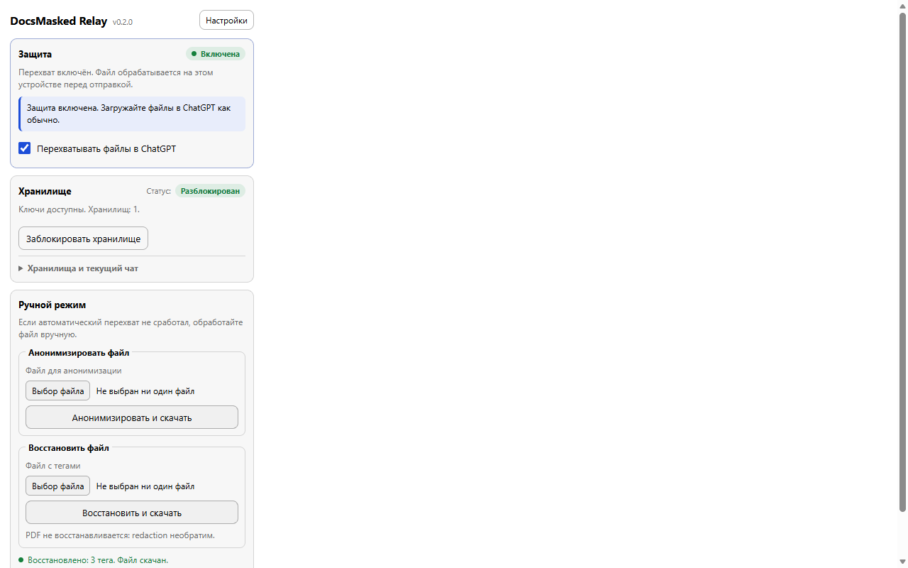
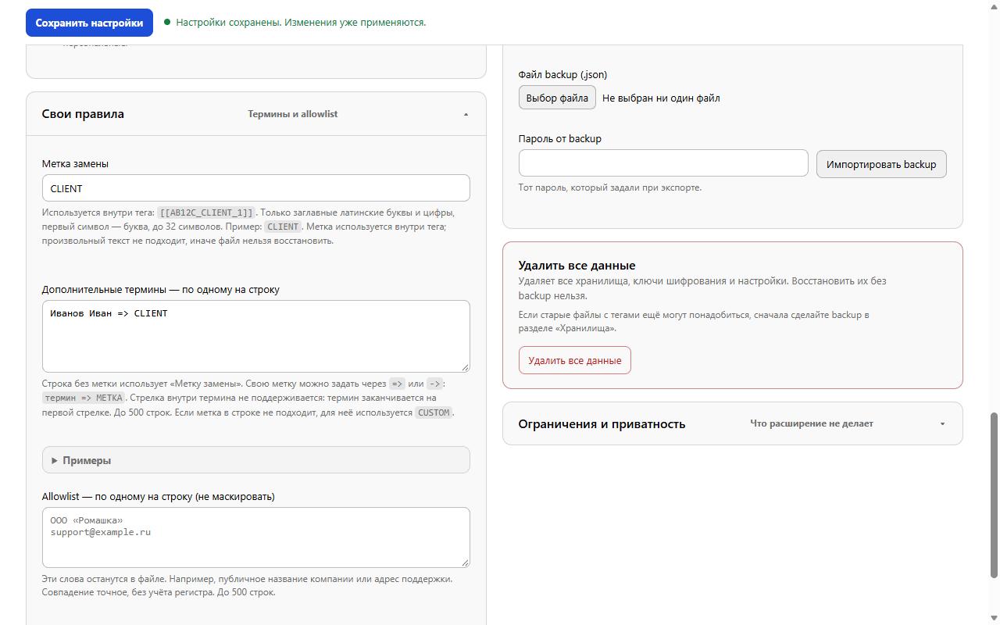
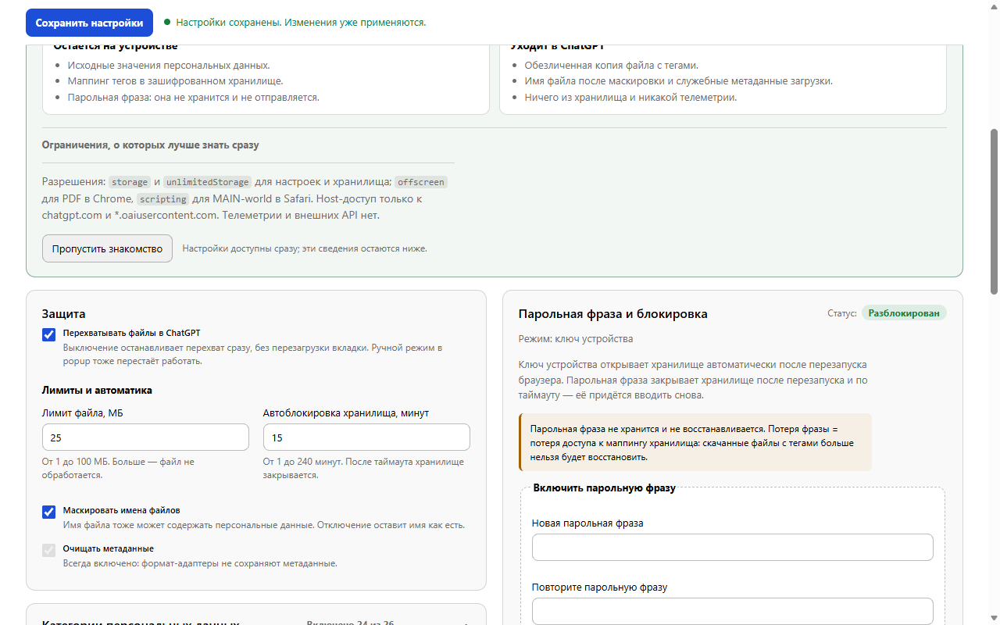
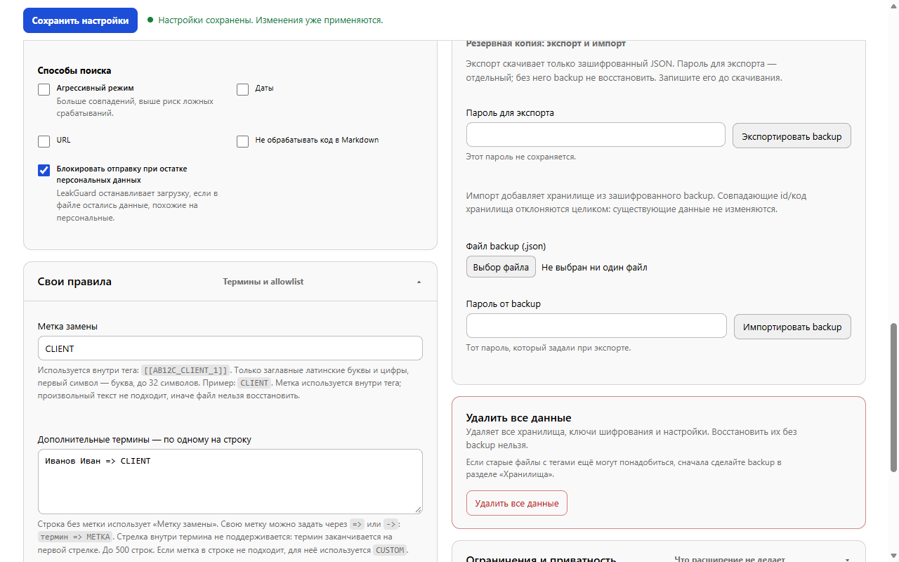

# DocsMasked Relay

Локальная анонимизация персональных данных (PII) в файлах для ChatGPT. Расширение
перехватывает загрузку файла, заменяет имена, телефоны, адреса, email и другие данные
метками, а при скачивании возвращает исходные значения из зашифрованного локального
хранилища. Сервера, аккаунта, телеметрии и рекламы нет.

**Статус: 0.2.0.** Chrome/Edge, Manifest V3. Safari Web Extension — отдельный трек для
macOS. Публикация в Chrome Web Store и Microsoft Edge Add-ons **ещё не выполнена**;
ссылки на магазины появятся только после ревью и публикации. Текущий Windows-установщик
работает офлайн и всё равно требует ручного `Load unpacked`.

## Что делает

| Сценарий | Поведение |
| --- | --- |
| Загрузка файла в ChatGPT | Локально маскирует PII, отправляет только обезличенные байты и обезличенное имя |
| Скачивание файла с метками | Возвращает исходные байты и имя из локального vault |
| Скачивание без меток | Сохраняет файл без изменений |
| Vault заблокирован | Загрузка отменяется (fail-closed), скачивание сохраняет файл как есть с предупреждением |
| Перехват выключен | Файлы проходят без обработки; перезагрузка вкладки не нужна |
| Ручной режим | «Анонимизировать» или «Восстановить» для выбранного файла в окне расширения |

Поддерживаемые форматы:

- **DOCX, XLSX** — текст, колонтитулы, комментарии, скрытые части и метаданные.
- **DOC, XLS** — старые форматы конвертируются в DOCX/XLSX; вёрстка, стили и макросы
  теряются.
- **TXT, Markdown** — с сохранением кодировки, BOM и переводов строк.
- **JSON, JSONL, XML** — строки, ключи, текстовые узлы, CDATA и атрибуты; опасные
  структуры отклоняются целиком.
- **PDF** — необратимое удаление (redaction) в одну сторону; до 200 страниц, сканы без
  текстового слоя блокируются.
- **Изображения и встроенные объекты** внутри документов не сканируются.

Лимит файла по умолчанию — 25 МБ (настраивается до 100 МБ). LeakGuard повторно проверяет
результат и блокирует отправку при остатках PII. Свои термины и список исключений
настраиваются в параметрах.

## Приватность

- Всё обрабатывается локально в браузере. Нет сервера, учётной записи, аналитики,
  телеметрии, рекламы, удалённой конфигурации и загружаемого кода.
- Vault хранится в IndexedDB расширения и шифруется AES-GCM-256. Ключ устройства —
  неэкспортируемый `CryptoKey`; дополнительная парольная фраза защищает master key через
  PBKDF2-SHA256 (600 000 итераций). Content scripts не получают ключи и исходные значения.
- В ChatGPT уходит только обезличенная копия файла и обезличенное имя. Исходные значения,
  ключи и vault остаются на устройстве.
- Метаданные документов очищаются всегда; отключить это нельзя.
- «Свои термины» и «Список исключений» хранятся в настройках **в открытом виде** — не
  вносите туда реальные PII.
- Экспорт vault — только зашифрованный JSON с отдельной парольной фразой.
- «Очистка данных» удаляет vault, ключи и настройки без возможности отмены.

Расширение не защищает от самого OpenAI: после отправки обезличенная копия хранится у
OpenAI по их правилам. Это также не юридическая консультация и не гарантия соблюдения
152-ФЗ.

### Ограничения

- **PDF — в одну сторону.** После redaction исходный PDF восстановить нельзя.
- **Нет OCR.** Сканы PDF без текстового слоя блокируются.
- Автоматическое распознавание вероятностное: может пропустить данные или заменить
  лишнее. LeakGuard снижает риск, но не устраняет его.
- Некоторые структуры отклоняются целиком, если их нельзя обезличить безопасно: числовые
  PII в JSON, XML с DOCTYPE/DTD или неизвестными сущностями, повреждённые архивы. Это
  безопасный отказ, а не утечка.
- Протокол chatgpt.com может измениться; запасной вариант — ручной режим.
- Safari: автоматический перехват — desktop Safari 18+; iOS не поддерживается.

## Установка

### Chrome Web Store / Edge Add-ons

Публикация пока не выполнена, публичных ссылок нет. Не устанавливайте сборки расширения из
непроверенных источников. После ревью ссылки будут добавлены сюда и в
[`store/`](store/README.md).

### Локальная сборка (Chrome / Edge)

Требования: Bun 1.4+ и Node.js 24; Chrome или Edge stable.

```bash
cd extension
bun install --frozen-lockfile
bun run build
```

Затем откройте `chrome://extensions` (или `edge://extensions`), включите режим
разработчика, нажмите **Load unpacked** и выберите `extension/.output/chrome-mv3`.
Готовый zip для магазина: `bun run zip` →
`extension/.output/docs-masked-relay-0.2.0-chrome.zip`.

### Windows: установщик для одного пользователя

[`installer/`](installer/README.md) содержит офлайн-установщик без прав администратора.
Он распаковывает расширение в `%LOCALAPPDATA%\DocsMaskedRelay`, создаёт ярлыки и
проверяет manifest. Установщик не подписан, не скачивает ничего из сети и **не
устанавливает расширение молча**: браузеры требуют включить режим разработчика и выбрать
папку через **Load unpacked**. Политики Chrome/Edge установщик не обходит.

### Enterprise: self-hosted CRX и политика

Для управляемых Windows-машин есть отдельный путь: собственный HTTPS-хостинг подписанного
CRX, `update.xml` и политика `ExtensionInstallForcelist`. Это требует прав администратора
и не является потребительской установкой в один клик. Инструкция, ключи и ограничения —
[`installer/enterprise/README.md`](installer/enterprise/README.md). Файл `key.pem` — секрет
подписи; его нельзя коммитить или публиковать.

### Safari (macOS)

Safari-сборка и подпись выполняются только на macOS с Xcode. На Windows доступна
статическая проверка `bun run build:safari`. Подробности —
[`extension/docs/safari-build.md`](extension/docs/safari-build.md).

## Разработка

```bash
cd extension
bun install --frozen-lockfile
bun run test          # Vitest: 684 теста в 46 файлах
bun run build         # Chrome MV3 → .output/chrome-mv3 (~15,8 МБ)
```

Полная проверка перед PR:

```bash
bun run ci            # Biome + tsc --noEmit + Vitest
bun run build
bun run zip
```

`bun run ci` — канонический unit/check-прогон; CI в GitHub Actions запускает его, затем
`build` и `zip` и публикует zip как artifact. E2E в CI не входит.

### E2E: фиксированный harness

E2E запускается только через `bun run test:e2e` (Playwright + собранное расширение +
mock chatgpt.com). Harness использует **один worker**, постоянный `userDataDir`, блокировку
профиля и fail-not-skip. Не добавляйте `--workers=N`: параллельные Chromium-процессы
против одного профиля недопустимы. В этом окружении e2e-прогон не выполнялся после
статического исправления harness; на Windows пустой persistent-профиль ранее приводил к
событиям 4625 и блокировке учётной записи. Подробности и правила —
[`docs/planning/e2e-harness-fix.md`](docs/planning/e2e-harness-fix.md).

## Скриншоты

Все изображения — реальный интерфейс с синтетическими данными.

| Окно расширения | Настройки |
| --- | --- |
|  |  |

| Две колонки настроек | Свои правила |
| --- | --- |
|  |  |

## Документация

- [Расширение: возможности, команды, устройство](extension/README.md)
- [Политика конфиденциальности](extension/PRIVACY.md)
- [Модель угроз и инварианты безопасности](extension/SECURITY.md)
- [Спецификация](docs/planning/extension-spec.md)
- [Release checklist](docs/planning/release-checklist.md)
- [Store-prep: листинги, privacy page, чек-лист](store/README.md)
- [Установщик для Windows](installer/README.md)
- [Enterprise: self-hosted CRX](installer/enterprise/README.md)
- [Safari build](extension/docs/safari-build.md)
- [Исследование форматов и инструментов](research/README.md)

## Лицензия

Код проекта распространяется по лицензии MIT — см. [`LICENSE`](LICENSE). Сторонние
компоненты, включая порт правил docs_masked, и их лицензии перечислены в
[`NOTICE`](NOTICE). Код расширения также сопровождается
[`extension/NOTICE`](extension/NOTICE).
